# Portfolio Performance & Risk Lab

A Python library, with a local web interface, for measuring the performance and risk of a
multi-asset portfolio from price and weight files. It computes returns, volatility,
risk-adjusted ratios, drawdowns, Value at Risk, concentration, risk contribution and
benchmark-relative statistics, rejects malformed input with specific messages, and documents
every formula and assumption.

**Status: early development (0.1.0 in preparation).** The calculation core, input validation,
tests, the Streamlit interface, PDF and Excel export, a theme customiser and optional price
download work. Several parts have only been tested offline; see
[Known limitations](#known-limitations) and [Roadmap](#roadmap).

## Quick start

Requires Python 3.12 or newer. The same steps work on macOS, Linux and Windows.

```bash
git clone https://github.com/exfps/portfolio-risk-lab.git
cd portfolio-risk-lab
python -m venv .venv
source .venv/bin/activate          # Windows (PowerShell): .venv\Scripts\Activate.ps1
python -m pip install -e ".[app]"
portfolio-risk-lab
```

A browser tab opens at `http://localhost:8501` showing the synthetic sample portfolio. Switch
the sidebar to **Upload CSV files** to analyse your own prices and weights. If the
`portfolio-risk-lab` command is not found, `python -m portfolio_risk` does the same thing.
Stop the app with Ctrl+C in the terminal.

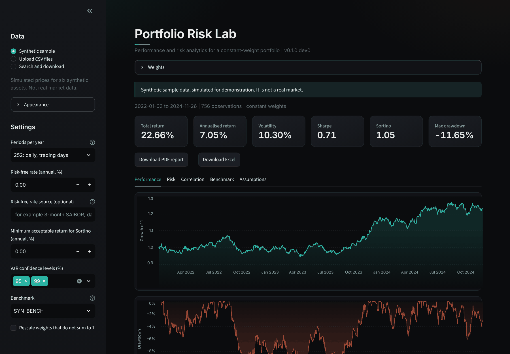

## Screenshots

All screenshots use synthetic data and a fake price provider (`scripts/demo_app.py`); nothing
here is real market data. They are regenerated with `python scripts/capture_screenshots.py`.

| | |
|---|---|
| 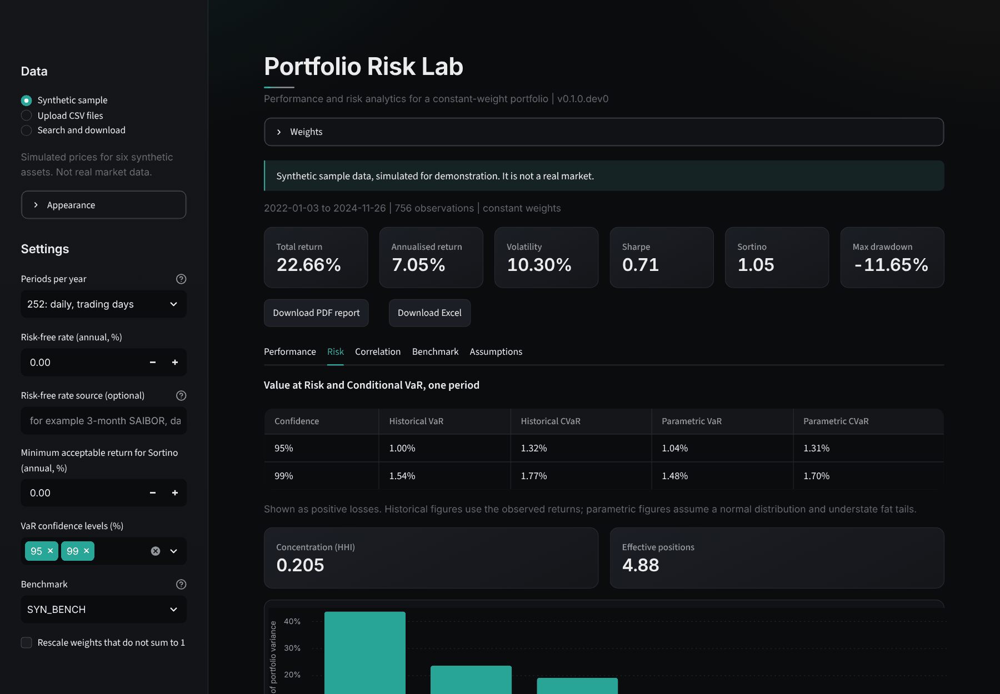 Risk: drawdown, VaR, contribution to risk | 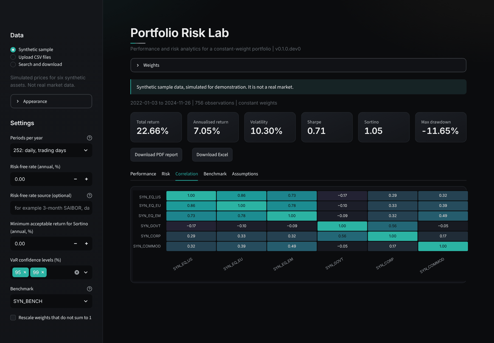 Correlation heatmap |
| 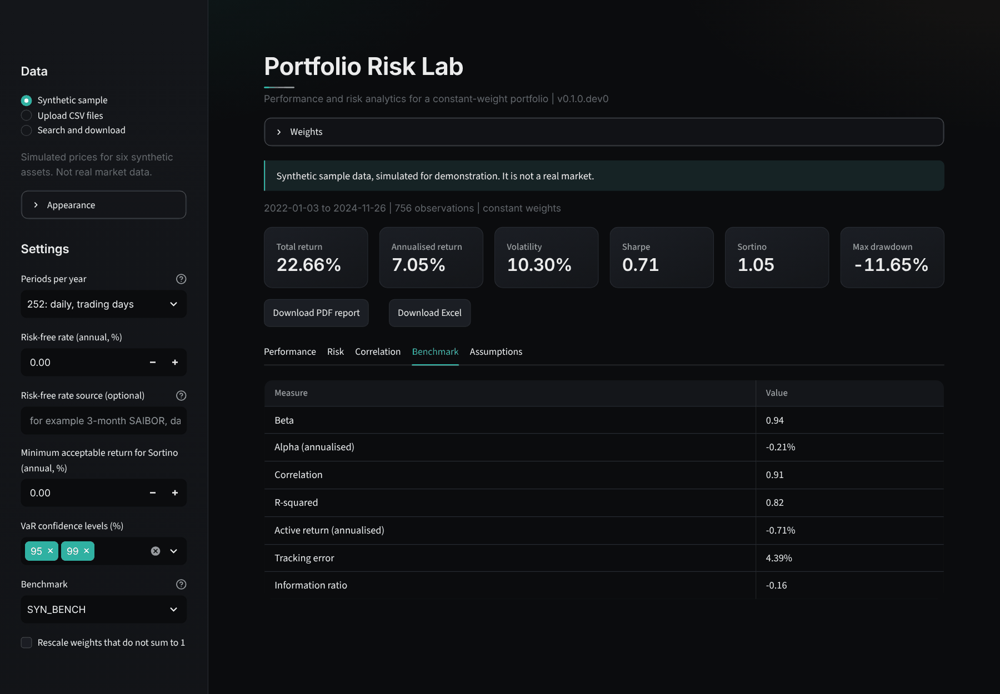 Benchmark-relative statistics | 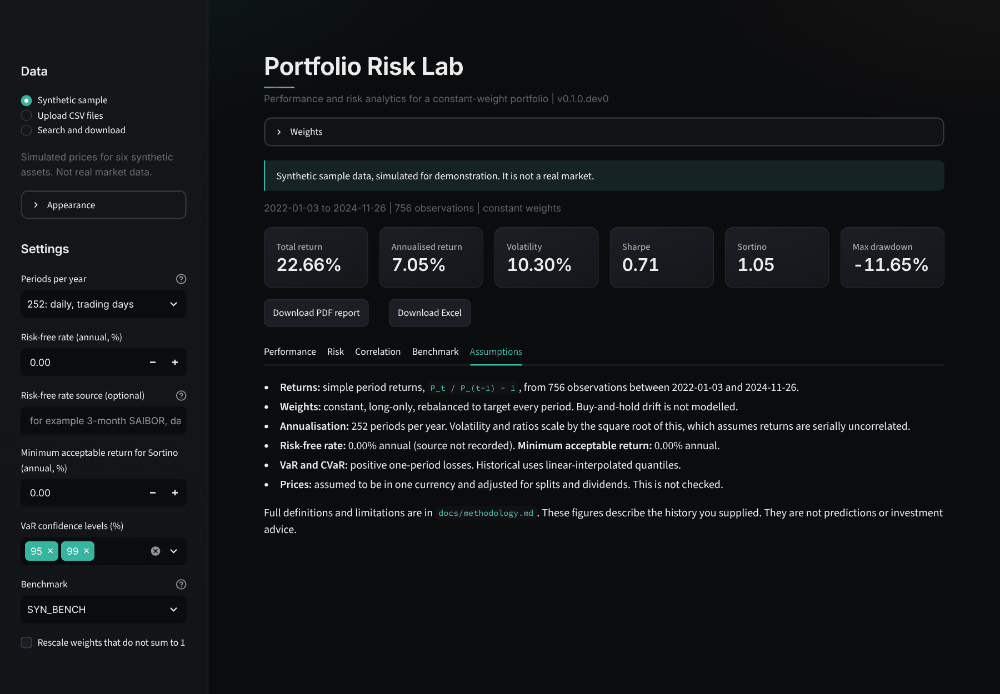 Assumptions in force |
| 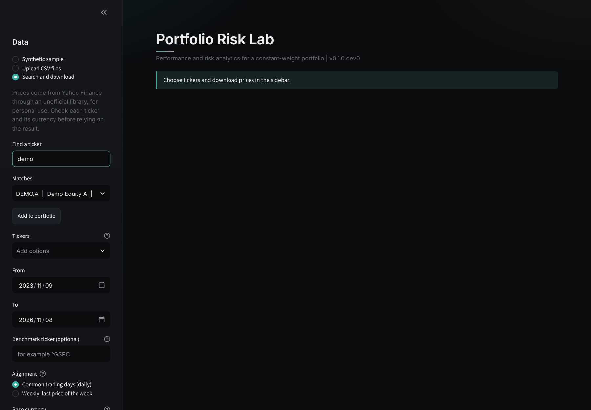 Ticker search | 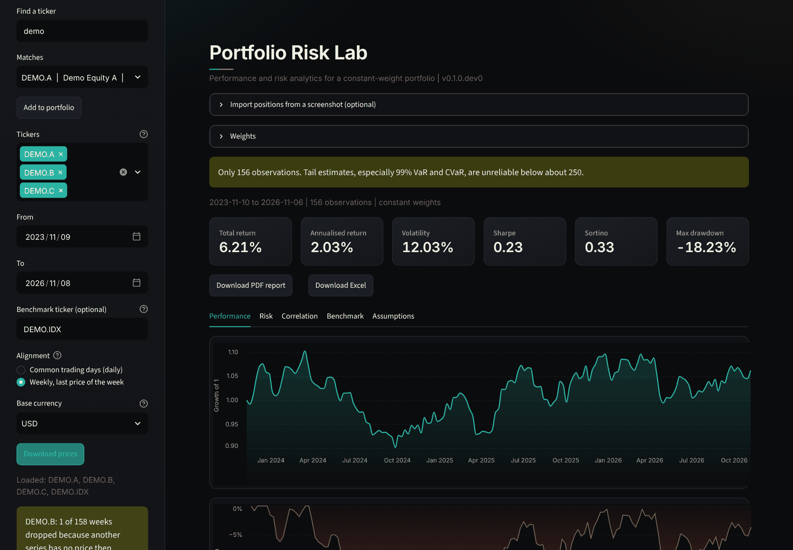 Downloaded, aligned, base-currency result |
| 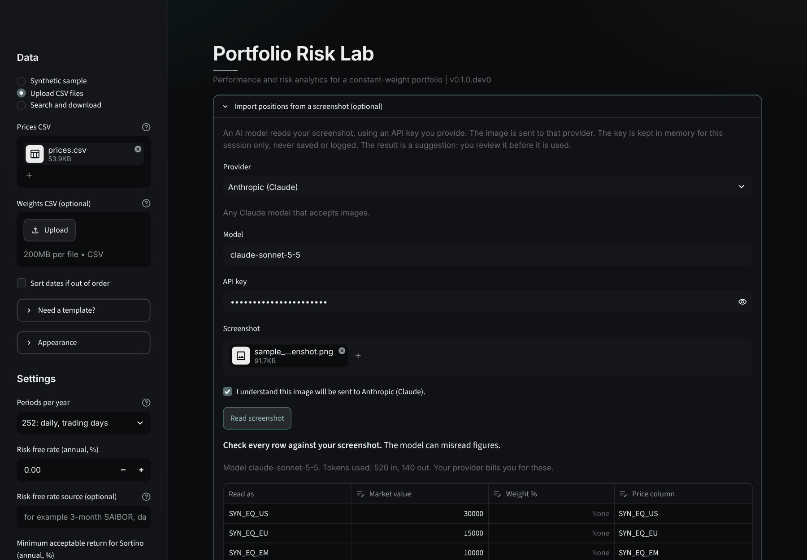 Screenshot import: review before use | 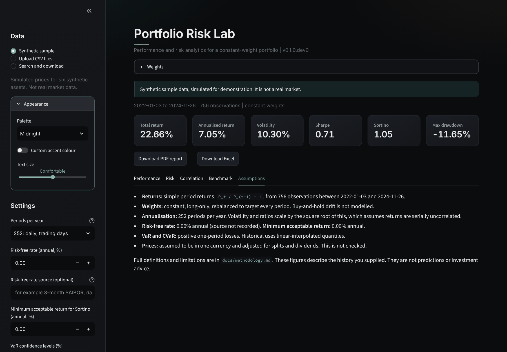 Appearance controls |
| 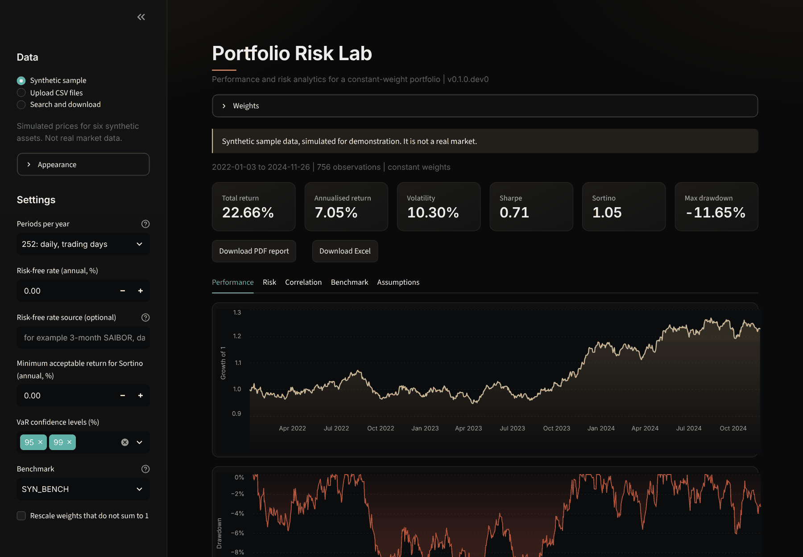 Preset theme | 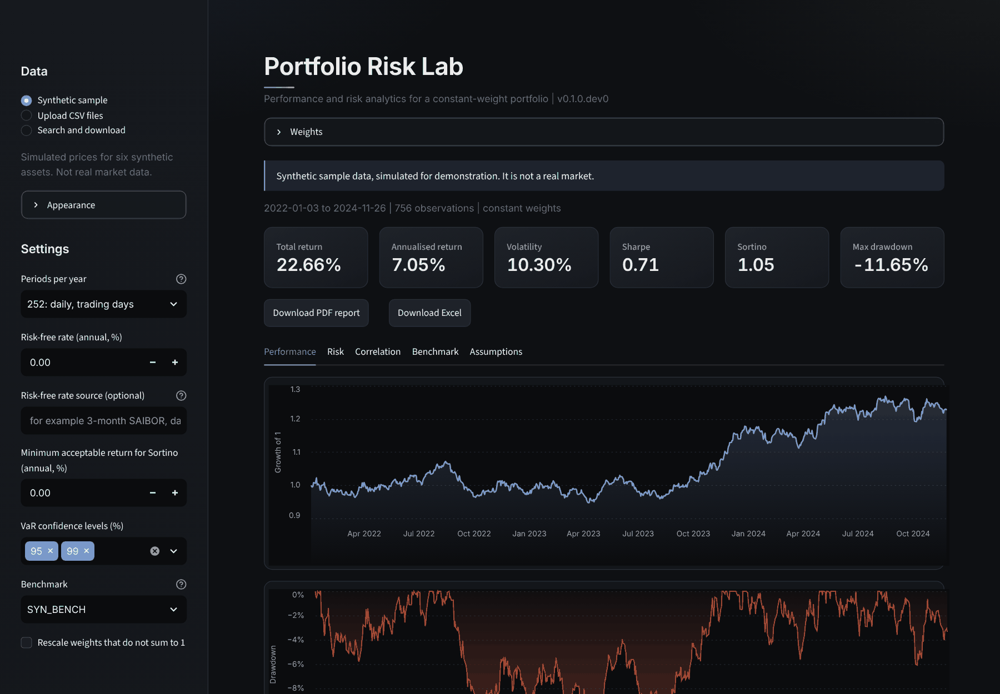 Graphite, large text |
| 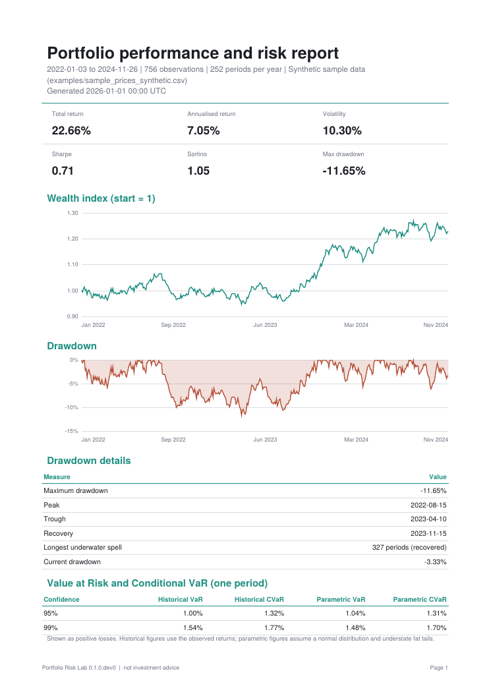 PDF report, page 1 | 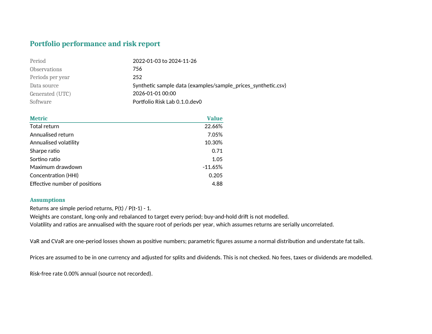 Excel workbook, summary sheet |

Example exports: [examples/sample_report.pdf](examples/sample_report.pdf) and
[examples/sample_report.xlsx](examples/sample_report.xlsx) (synthetic data).

## Problem

Retail investors, students and junior analysts often hold several assets and can see price
charts but not risk-adjusted performance: how much of the portfolio's risk comes from one
position, how deep and how long the worst drawdown was, or what a bad day is likely to cost.
Spreadsheets get these wrong in quiet ways (the wrong Sortino denominator, volatility annualised
by the wrong factor, silently filled gaps in the data). This project implements the standard
measures carefully, tests each against a hand-worked example, and states its assumptions.

## Features

Implemented:

- Total return, annualised return, wealth index
- Annualised volatility, Sharpe ratio, Sortino ratio
- Drawdown series, maximum drawdown with peak, trough and recovery dates, longest underwater
  duration, current drawdown
- Historical and parametric (normal) VaR and CVaR at configurable confidence levels
- Correlation and covariance, Herfindahl-Hirschman concentration, effective number of
  positions, contribution to risk
- Beta, annualised alpha, tracking error, information ratio against a benchmark
- CSV loading with line-specific errors, and validation of dates, prices, missing data, sample
  length, suspicious price jumps, weights, column alignment and annualisation frequency
- Seeded synthetic sample data
- Streamlit interface: sample or uploaded CSV data, editable weights, benchmark selection,
  performance, risk, correlation and benchmark tabs, and an assumptions summary
- Optional price download by ticker (Yahoo Finance via `yfinance`, replaceable provider), with
  search, common-day or weekly alignment and optional conversion to a base currency using daily
  exchange rates from the same source. Downloads run in parallel and results are cached in memory
  for 15 minutes. Offline-tested only.
- PDF report (three pages) and Excel workbook (summary, returns, drawdown, risk, correlation
  with native charts), built only when you click the download button. Each states the data
  source, assumptions and a not-advice notice.
- Theme customiser: four presets, a custom accent colour (automatically lightened if its contrast
  against the background is too low), three text sizes, kept in the page address so a bookmark
  restores it. Exports use a print-safe version of the accent.
- Optional import of positions from a screenshot, using your own Anthropic, OpenAI or DeepSeek
  API key. The result is shown for review and editing before it becomes weights.

Not implemented yet: time-weighted and money-weighted returns, buy-and-hold drift, rolling
statistics, Monte Carlo, factor regression.

## Example

Results for the bundled **synthetic** sample (six simulated assets, 756 daily returns, constant
weights). These numbers describe simulated data, not any real market.

| Statistic | Value |
|---|---|
| Total return | 22.66% |
| Annualised return | 7.05% |
| Annualised volatility | 10.30% |
| Sharpe ratio (risk-free 0%) | 0.71 |
| Maximum drawdown | -11.65% (peak 2022-08-15, trough 2023-04-10, recovered 2023-11-15) |
| 95% one-day historical VaR | 1.00% |
| Beta to the synthetic benchmark | 0.94 |

## Technology

Python 3.12+, NumPy, pandas. Interface: Streamlit and Altair. Exports: reportlab (PDF) and
openpyxl (Excel). Optional price data: yfinance. Development: pytest, Hypothesis,
ruff, mypy (strict). No database. Files in, results out.

## Architecture

The core is a plain library with no UI, network or environment dependencies. Metrics are pure
functions; loaders and validators turn untrusted files into clean pandas objects; `analyse()`
runs the pipeline and returns one immutable result with warnings. The Streamlit interface
(`portfolio_risk.ui`) only collects inputs and displays that result; the core never imports it.
Details are in
[docs/architecture.md](docs/architecture.md).

## Installation

```bash
git clone https://github.com/exfps/portfolio-risk-lab.git
cd portfolio-risk-lab
python -m venv .venv
source .venv/bin/activate          # Windows: .venv\Scripts\activate
python -m pip install -e .          # library only
python -m pip install -e ".[app]"   # library and interface
python -m pip install -e ".[app,data]" # plus price download (yfinance)
```

For development, install `".[dev]"` instead. The interface needs Streamlit 1.58 or newer
(older releases fail with current Altair or lack the test helpers).

## Configuration

`AnalysisConfig` holds every parameter that changes a result:

| Parameter | Default | Meaning |
|---|---|---|
| `periods_per_year` | 252 | Annualisation factor (365 daily incl. weekends, 52 weekly, 12 monthly) |
| `risk_free_annual` | 0.0 | Effective annual risk-free rate |
| `mar_annual` | 0.0 | Minimum acceptable annual return for Sortino |
| `confidence_levels` | (0.95, 0.99) | VaR and CVaR levels |
| `min_observations` | 60 | Fewest returns accepted |

The only environment variable is `PORTFOLIO_RISK_DISABLE_DOWNLOAD=1`, which hides the price
download source (useful for a hosted demo). `.env.example` documents it. No API key is ever read
from the environment or a file: the screenshot-import key is typed into the page and kept in
memory for the session. The interface exposes the same settings as `AnalysisConfig` in its sidebar. Its colours
are set in `.streamlit/config.toml` and `src/portfolio_risk/ui/theme.py`.

## Usage

Input files are a wide price table and a weights file:

```csv
date,SYN_EQ_US,SYN_GOVT,SYN_BENCH
2022-01-03,100.0000,100.0000,100.0000
```

```csv
ticker,weight
SYN_EQ_US,0.30
SYN_GOVT,0.70
```

To use the interface instead, run `portfolio-risk-lab`; see [Quick start](#quick-start) and
[docs/user-guide.md](docs/user-guide.md#the-interface). From Python:

```python
from portfolio_risk import AnalysisConfig, analyse, load_prices, load_weights

prices = load_prices("examples/sample_prices_synthetic.csv")
weights = load_weights("examples/sample_weights_synthetic.csv")
result = analyse(prices, weights, AnalysisConfig(), benchmark="SYN_BENCH")

print(result.performance.sharpe_ratio)
print(result.performance.drawdown.max_drawdown)
print(result.risk_contribution)
for note in result.warnings:
    print("warning:", note)
```

The full file format, result fields and error messages are in
[docs/user-guide.md](docs/user-guide.md).

## Project structure

```
src/portfolio_risk/   library (see docs/architecture.md)
  data/               optional price providers, alignment, FX, cache
  report/             PDF and Excel exporters
  vision/             optional screenshot import (bring your own key)
  ui/                 Streamlit interface, charts, theme customiser
tests/                unit, property-based, malformed-input and interface tests
examples/             synthetic sample prices and weights
scripts/              sample data, example reports, screenshot capture, browser check
screenshots/          interface screenshots (synthetic data)
streamlit_app.py      entry point for Streamlit Community Cloud
docs/                 methodology, architecture, user guide
```

## Testing

```bash
python -m pytest --cov
ruff check . && ruff format --check . && mypy
```

The suite has 298 tests. Each metric is checked against a value worked by hand (the working is
in the test and in [docs/methodology.md](docs/methodology.md)), against properties that must
always hold (contributions sum to 1, CVaR is at least VaR, drawdown is within [-1, 0]), and
against malformed input. Line coverage is 99%. That figure excludes `ui/app.py`, because
Streamlit's test harness runs the script in a way coverage cannot trace; seven tests in
`tests/test_ui_app.py` do exercise it. `scripts/browser_check.py` is an optional end-to-end check
that drives the running app in Chromium (28 checks, including malformed and Windows-style
files); it needs `pip install playwright` and `python -m playwright install chromium`.
It was run on Linux with Python 3.13. Windows has not been tested on real hardware; CI runs the
tests on Windows as well as Linux, but the browser check is Linux-only.

## Roadmap

Detailed status is in [docs/roadmap.md](docs/roadmap.md).

1. **0.1.0:** verify price download and Gulf coverage against the live provider, deploy on
   Streamlit Community Cloud, confirm on Windows.
2. **GCC support:** Gulf trading calendars, local benchmark shortcuts, Shariah-screen flag,
   Arabic and right-to-left layout.
3. **Done:** price download, base-currency conversion, PDF and Excel export, theme customiser.
4. **0.2:** harden the screenshot import: test against the real provider APIs, downscale images
   and strip metadata before sending.
5. **0.3:** transactions input, time-weighted and money-weighted returns (XIRR), buy-and-hold.
6. **Later:** rolling statistics and regimes, Monte Carlo, factor regression.

## Known limitations

- Constant, long-only weights. No buy-and-hold drift, shorts or leverage.
- Currency conversion exists only for downloaded prices (provider exchange rates, last rate on or
  before each date); uploaded CSVs are never converted. Prices assumed adjusted; no fees, taxes or dividends are modelled.
- VaR and the annualised ratios rely on assumptions (a representative sample, serially
  uncorrelated returns, normality for the parametric variants) that real returns violate.
- Tail estimates from fewer than about 250 observations are unreliable.
- The library checks for corrupt input, not for incorrect input.

The full list is in [docs/methodology.md](docs/methodology.md#10-limitations). These are
analytical tools, not investment advice or a guarantee of future performance.

## Data sources and attribution

The interface bundles one font, Inter, under the SIL Open Font License 1.1
(`src/portfolio_risk/ui/fonts/`, licence text alongside). It is embedded in the page, so the
interface requests nothing from a font service.

The only data in this repository is **synthetic**, generated by `scripts/generate_sample.py`
from a seeded simulation. It is not derived from any market data vendor. Future releases may
document further optional sources such as FRED.

The optional *Search and download* feature fetches prices from Yahoo Finance at the user's
request through the unofficial `yfinance` library. Yahoo's terms limit that data to personal use;
nothing downloaded is stored in or redistributed by this repository. It has been tested against a
fake client only, so live behaviour and Gulf exchange coverage are unverified. Use a licensed
provider (the interface in `portfolio_risk.data.base`) for any commercial use.

## Security considerations

The core library performs no network access and writes no files. The interface runs on your own
machine and keeps uploads in memory only; Streamlit usage statistics are switched off in
`.streamlit/config.toml`. Two optional features make requests, and only when you use them:
screenshot import sends the image to the provider you choose, with your API key, and price
download sends ticker symbols and dates to Yahoo Finance. Portfolio files can be sensitive: do not
commit real holdings. See [SECURITY.md](SECURITY.md) for exactly what that feature does and does
not protect.

## Contributing

See [CONTRIBUTING.md](CONTRIBUTING.md). Formula changes need a hand-calculated test and a
methodology update.

## Licence

MIT. See [LICENSE](LICENSE).
